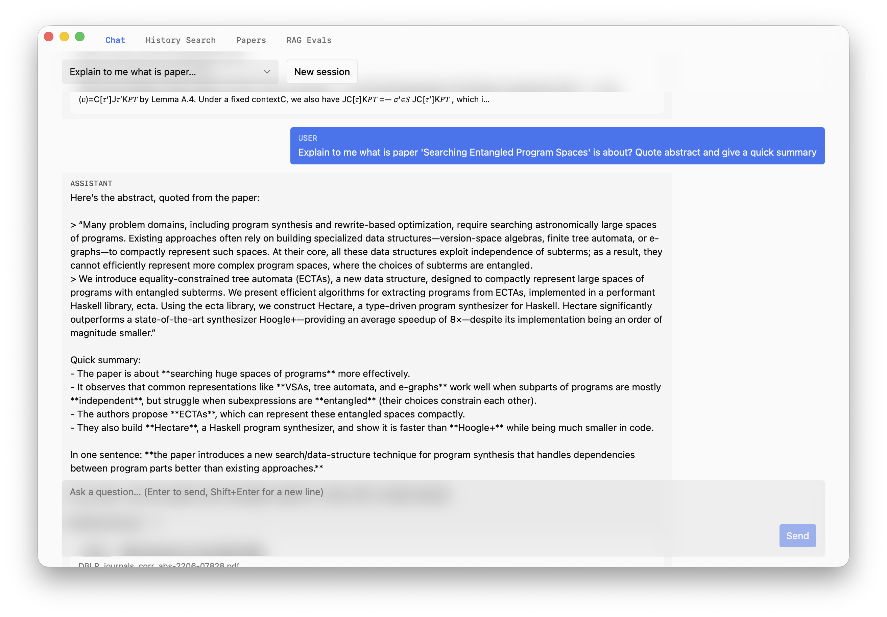
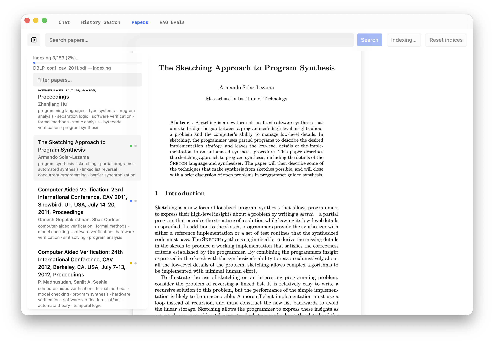
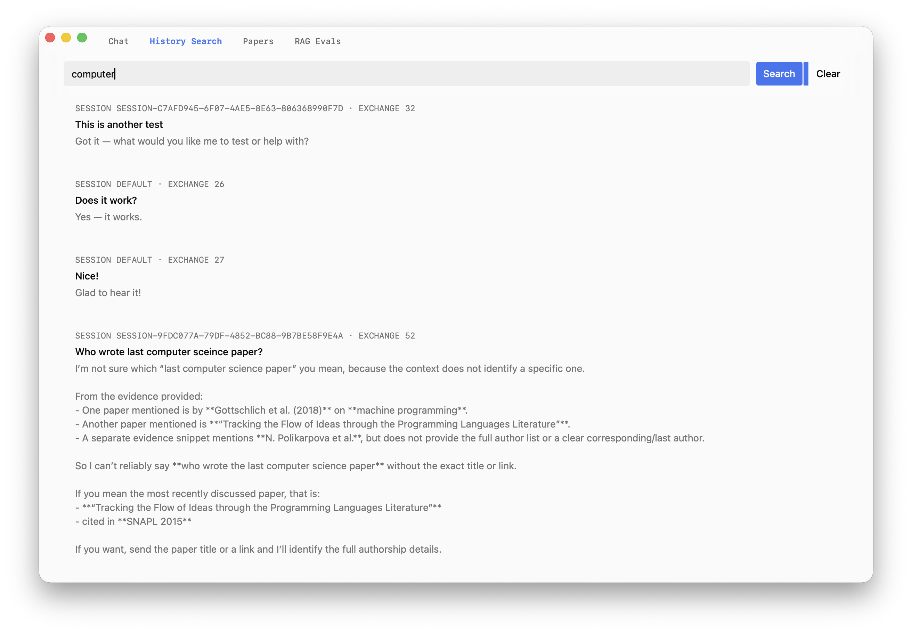
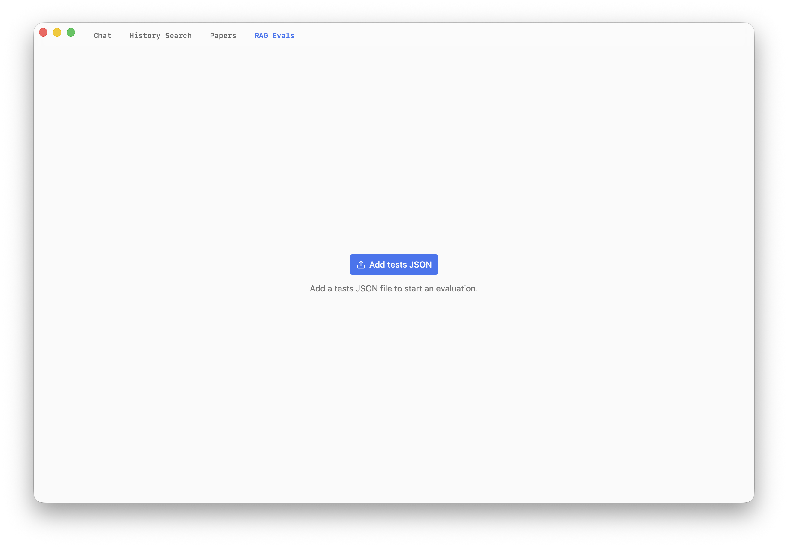

# Research assistant capstone

A research-paper assistant with a Svelte/Tauri desktop interface and a Python
backend for PDF indexing, hybrid retrieval, grounded Chat, and RAG evaluation.

- [Getting started](documentation/getting-started.md)
- [Current application documentation](documentation/README.md)

The desktop frontend is in `app/`, the Python backend is in `src/`, and regression
tests are in `tests/` and `app/tests/`. Local PDFs and private runtime data are
user-managed inputs, not application source.

## Purpose

The system helps researchers work with a local collection of academic papers by
answering questions across those papers with grounded, cited passages and page
numbers.

- **Chat:** adaptive multi-hop answering (plan, hybrid retrieval, subanswers,
  coverage review, final answer) with sources.
- **Papers:** browse and read the local PDFs, before or after searching, and open
  them from Chat sources.
- **History:** search saved conversations.
- **RAG Evals:** run batteries of test questions, scored by an LLM judge, with
  latency, token, and cost metrics, to validate changes to the RAG system.

## Screenshots

**Chat** — a grounded answer quoting a paper's abstract, with a summary.



**Papers** — paper list with authors and topics, the PDF reader, and indexing
progress.



**History Search** — search across saved conversations.



**RAG Evals** — upload a tests JSON file to start an evaluation.



## Requirements

| Dependency | Version / note |
| --- | --- |
| Node.js and npm | `^20.19.0` or `>=22.12.0` (required by Vite 8) |
| Rust toolchain | Tauri 2 platform prerequisites; manifest declares Rust 1.77 |
| Conda | Creates the `ragcourse` environment with Python 3.11 ([`environment.yml`](environment.yml)) |
| PDFs | Placed in `ResearchPapers/` (default) or a configured directory |
| Provider account | OpenAI or OpenRouter key for real model and embedding behavior |

Python packages (from `environment.yml`): `pymupdf4llm`, `python-dotenv`,
`langchain-openai`, `langchain-core`, `openai`, `chromadb`, `pypdf`,
`pycozo[embedded]`, `langgraph`. `pytest` is not included; install it separately
to run the Python tests.

## Quick start

Run every command from the repository root unless a step says otherwise.
Commands marked **macOS/Linux** are for Terminal (bash or zsh). Commands marked
**Windows** are for PowerShell. Where only one block is shown, it works in both.

The Windows commands have not been tested.

### Step 1 — Check the tools

```bash
node -v      # must be 20.19+ or 22.12+
npm -v
cargo -V     # Rust toolchain
conda -V
```

If a tool is missing, install it first. For Rust and the platform libraries Tauri
needs, follow the [Tauri prerequisites](https://tauri.app/start/prerequisites/).

### Step 2 — Create the Python environment

```bash
conda env create -f environment.yml
```

This creates an environment named `ragcourse`. If it already exists, update it
instead:

```bash
conda env update -n ragcourse -f environment.yml --prune
```

### Step 3 — Install the frontend dependencies

```bash
cd app
npm ci
cd ..
```

### Step 4 — Add your API key

Copy the example settings file. Both commands keep an existing `.env`.

**macOS/Linux**

```bash
cp -n .env.example .env
```

**Windows**

```powershell
if (-not (Test-Path .env)) { Copy-Item .env.example .env }
```

Open `.env` in an editor and set **one** of:

- `OPENAI_API_KEY=` your OpenAI key, or
- `OPENROUTER_API_KEY=` your OpenRouter key.

Leave the other key line empty, and leave other lines empty to use the defaults.
Do not commit `.env` or type keys on the command line.

### Step 5 — Add the papers

Put the PDF files in `ResearchPapers/` in the repository root.

### Step 6 — Start the app

**macOS/Linux**

```bash
cd app
npm run tauri -- dev
```

**Windows**

The `tauri` npm script uses macOS/Linux shell syntax to find the `ragcourse`
Python, so on Windows set that path yourself and call Tauri directly:

```powershell
cd app
$env:CAPSTONE_PYTHON = (conda run -n ragcourse python -c "import sys; print(sys.executable)")
npx tauri dev
```

The first start compiles the Rust shell and can take several minutes. A desktop
window opens when it is ready. Keep this terminal open; press `Ctrl+C` in it to
stop the app.

Do not use `npm run dev` to start the app: it opens only a web page that cannot
reach the Python backend.

### Step 7 — First use in the app

1. Open **Papers** and check that your PDFs are listed.
2. Click **Index papers** and wait for it to finish. This calls the embedding and
   chat models and costs money.
3. Ask a question in **Chat**.
4. Optional: in **RAG Evals**, upload `tests/eval_questions_performance.json`
   (10 cases) or `tests/eval_questions.json` (60 cases). The run starts as soon
   as a valid file is uploaded, and it also costs money.

### If something goes wrong

| Symptom | Cause and fix |
| --- | --- |
| Start fails with a port error | Port 1420 is in use. Close the other program using it, then start again. |
| Window opens but Chat or indexing fails with Python import errors | The app did not find the `ragcourse` environment and fell back to `python3`. On macOS/Linux, start it from `app/` with `CAPSTONE_PYTHON="$(conda run -n ragcourse printenv CONDA_PREFIX)/bin/python" npm run tauri -- dev`. On Windows, check that `$env:CAPSTONE_PYTHON` is set as in step 6 before running `npx tauri dev`. |
| **Papers** is empty | The PDFs are not in `ResearchPapers/`, or `CAPSTONE_PAPERS_DIR` points elsewhere. |
| Answers look generic or fake | No API key was found, so the backend uses a mock model. Check `.env`. |

More help: [Getting started](documentation/getting-started.md) and
[Operations and testing](documentation/operations-and-testing.md).

## Configuration reference

All settings are optional except one API key. Set them in `.env` in the
repository root. Python loads this file without overriding variables already set
in the shell.

| Variable | Default | Purpose |
| --- | --- | --- |
| `OPENAI_API_KEY` | unset | OpenAI credential (takes precedence) |
| `OPENROUTER_API_KEY` | unset | Used when no OpenAI key is set |
| `CAPSTONE_CHAT_MODEL` | `gpt-4o-mini` (OpenAI) / `openai/gpt-5.4-mini` (OpenRouter) | Chat model |
| `CAPSTONE_CHAT_BASE_URL` | Provider default | Chat endpoint |
| `CAPSTONE_EMBED_MODEL` | `text-embedding-3-small` | Embedding model; must match the stored index |
| `CAPSTONE_EMBED_BASE_URL` | Chat base URL | Embedding endpoint |
| `CAPSTONE_CHAT_MAX_TOKENS` | unset | Optional output cap |
| `CAPSTONE_SYSTEM_PROMPT` | unset | Optional system prompt override |
| `CAPSTONE_INDEX_MAX_WORKERS` | `4` | Parallel paper indexing workers |
| `CAPSTONE_PAPERS_DIR` | `ResearchPapers/` | PDF directory |
| `CAPSTONE_DB_PATH` | `data/chat_history.sqlite3` | Chat history and paper statuses |
| `CAPSTONE_CHROMA_DIR` | `data/chroma/` | Vector store and BM25 index |
| `CAPSTONE_LOG_PATH` | `data/chat_logs.txt` | Chat log |
| `CAPSTONE_RETRIEVAL_LOG_PATH` | `data/retrieval_logs.txt` | Retrieval log |
| `CAPSTONE_PYTHON` | Conda `ragcourse` interpreter | Python used by the desktop app |
| `CAPSTONE_PROJECT_ROOT` | Repository root | Working directory for the Python process |

Without an API key the backend uses a deterministic mock model and a local hashing
embedder. This is for development only and does not reflect answer quality.

`CAPSTONE_PAPERS_DIR`, `CAPSTONE_PYTHON`, and `CAPSTONE_PROJECT_ROOT` are read by
the desktop shell from the parent environment, not from `.env`. Set them in the
shell that launches the app when you change them. See
[Configuration](documentation/configuration.md) for details.

## Tests

```bash
# Python (from the repository root; requires pytest)
conda run -n ragcourse python -m pytest -q tests

# Frontend (from app/)
npm run check
node --test tests/router.test.mjs tests/search-collections.test.mjs

# Rust (from app/src-tauri/)
cargo test --locked
```

See [Operations and testing](documentation/operations-and-testing.md) for focused
suites and safe troubleshooting.

## Known limitations and reviewer notes

- **Paid operations:** indexing, Chat, and evaluations call provider APIs when a
  key is configured. A full 70-case evaluation cost about $1.78.
- **Development build only:** `npm run tauri -- build` does not bundle Python,
  dependencies, or the paper corpus; the app runs from the repository layout.
- **Prompt injection:** retrieved text is marked as untrusted, but this relies on
  the model following its prompt.
- **Evaluation:** scores come from an LLM judge, not deterministic ground truth.
  Citation accuracy is not measured.
- **Retrieval:** broad enumeration and cross-corpus comparison questions score
  lowest. Scores are relative rankings, not calibrated confidence.
- **Index consistency:** Chroma, CozoDB, BM25, and SQLite are updated without a
  shared transaction. The BM25 freshness check compares chunk counts only.
  Replacing a PDF under the same filename requires explicit reindexing.
- **Embedding changes:** changing the embedding model or provider requires
  rebuilding the index.
- **Reset:** "reset all indices" deletes derived data and is not reversible
  without reindexing; PDFs and chat history are kept.
- **Logs:** chat and retrieval logs contain questions, answers, and retrieved
  text. Do not share them publicly.
- **Security:** the Tauri configuration has `csp: null`.
- **Cancellation:** closing a Chat stream does not guarantee the Python process
  stopped.
